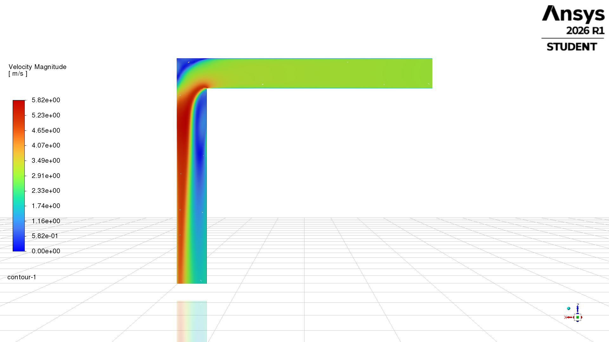
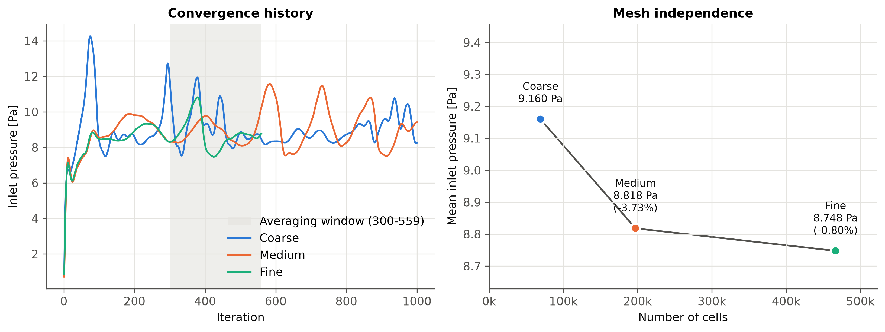
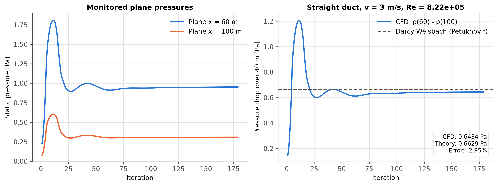
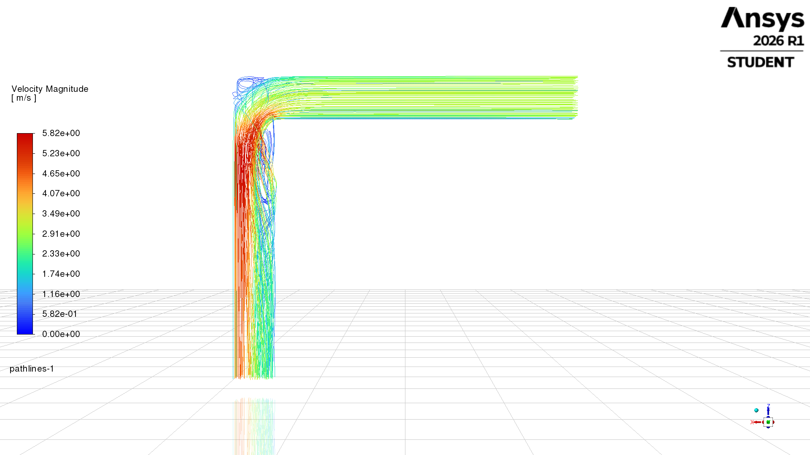
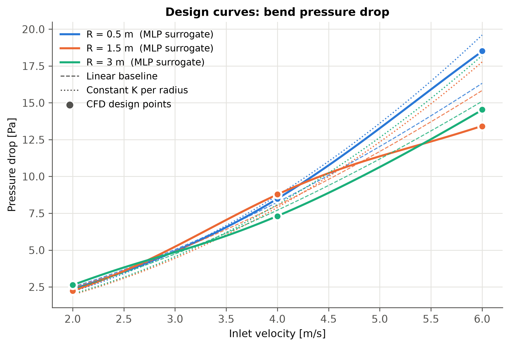
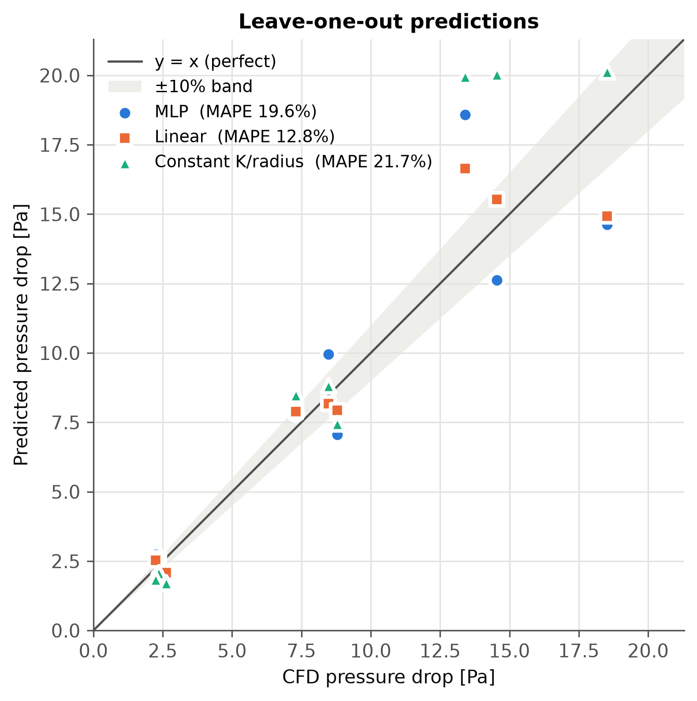

# Mine Ventilation CFD & Machine Learning Surrogate

A 3D CFD study of airflow through a mine ventilation tunnel with a 90° bend, built in **ANSYS Fluent**, validated against textbook correlations, and paired with **machine learning surrogate models** that predict pressure loss in milliseconds instead of hours.



## Why this matters

Ventilation is one of the largest energy costs in underground mining. Every bend in a tunnel causes a pressure loss that the fans must overcome. This project asks: **how much pressure does a 90° bend cost, how does rounding its inner corner change that, and can a fast surrogate model replace slow simulations for design exploration?**

## Setup

| Item | Value |
|---|---|
| Geometry | L-shaped tunnel, 4 m × 4 m cross-section, ~60 m centreline, 90° bend |
| Solver | ANSYS Fluent 2026 R1 (Student), pressure-based, coupled |
| Turbulence model | k-ω SST |
| Fluid | Air (ρ = 1.225 kg/m³, μ = 1.7894×10⁻⁵ Pa·s) |
| Boundary conditions | Velocity inlet (5% intensity, D_h = 4 m), pressure outlet (0 Pa), no-slip walls |
| Mesh | Poly-hexcore with 5 boundary layers; 197k cells for production runs |
| Reynolds number | ~8 × 10⁵ at 3 m/s |

## 1. Verification and validation

### Mesh independence
Three meshes were solved at 3 m/s with a sharp corner. Pressure drop was averaged over iterations 300–559.

| Mesh | Cells | Pressure drop | Change |
|---|---|---|---|
| Coarse | 69,202 | 9.160 Pa | n/a |
| Medium | 197,202 | 8.818 Pa | −3.73% |
| Fine | 466,684 | 8.748 Pa | **−0.80%** |

Medium and fine meshes agree within 0.8%, so the medium mesh was used for all further work. **Caveat:** the steady solution oscillates by about ±2 Pa, and shifting the averaging window moves the medium-mesh result by about 4.5%. The mesh study is consistent with mesh independence, but the oscillation uncertainty is larger than the mesh-to-mesh difference.



### Validation against Darcy–Weisbach
A straight 120 m duct with the same cross-section and mesh settings was simulated at 3 m/s. The pressure drop was measured between planes 60 m and 100 m from the inlet, where the flow is close to fully developed.

| Source | Pressure drop over 40 m |
|---|---|
| CFD | 0.6434 Pa |
| Darcy–Weisbach (Petukhov friction factor, f = 0.01203) | 0.6629 Pa |
| **Error** | **−2.95%** |

This confirms the turbulence model, wall treatment, and mesh resolve wall friction correctly.



## 2. Flow physics at the bend



Air entering the bend is thrown toward the outer wall, forming a high-speed jet (up to ~5.8 m/s at a 3 m/s inlet). Two recirculation zones form: a **separation bubble** along the inner wall just after the corner, and a **corner vortex** in the outer corner. These zones are where most of the bend's pressure loss comes from.

## 3. Steady vs transient: a key finding

The first parametric sweep used steady-state RANS with a 200-iteration averaging window. The results broke basic physics: the loss coefficient K = Δp / (½ρV²) jumped between 0.43 and 1.20 for the same geometry, and in one case a higher velocity gave a *lower* pressure drop.

Inspecting the raw inlet-pressure history showed why. The steady solver settled near 2.5–2.9 Pa for ~400 iterations, then broke into irregular 2.6–10 Pa bursts. A time-accurate (transient) run of the same case settled within ~10 s of flow time into small ±0.1 Pa fluctuations, with two independent averaging windows agreeing within ~1%.

**Conclusion:** the bursts were a solver artifact from forcing a steady method onto unsteady separated flow. All final results use **transient simulations** (Δt = 0.05 s, 1,200 time steps, averaged over the final 40 s).

## 4. Parametric study

Nine transient cases were run automatically with ANSYS Workbench design points: inner-corner radius of 0.5, 1.5, and 3 m, crossed with inlet velocity of 2, 4, and 6 m/s.

| Radius | K at 2 m/s | K at 4 m/s | K at 6 m/s |
|---|---|---|---|
| 0.5 m | 0.96 | 0.87 | 0.84 |
| 1.5 m | 0.91 | 0.90 | 0.61 |
| 3.0 m | 1.07 | 0.75 | 0.66 |

At higher velocities, larger inner-corner radii lower the loss coefficient. Rounding only the *inner* corner gives limited benefit overall, since the sharp outer corner and its vortex remain.



## 5. Surrogate models

Three models were trained to predict K from radius and Reynolds number, then converted back to pressure drop. Each was tested with leave-one-out cross-validation, so every prediction is on a point the model never saw.

| Model | Leave-one-out error (MAPE on Δp) |
|---|---|
| **Linear regression (radius + log Re)** | **12.8%** |
| PyTorch MLP (2-8-1, tanh, 5-network ensemble) | 19.6% |
| Physics baseline (constant K per radius) | 21.7% |

**Takeaways:**
- With only 9 data points, the simplest model with one physics-shaped term (log Re) beats the neural network, which overfits the noise. **Data quantity and quality, not model complexity, limit accuracy here.**
- The constant-K baseline fails because K varies with velocity in this data. Part of that trend may be numerical (see Limitations).
- A surrogate prediction takes well under a millisecond, versus ~2.5 hours per transient CFD run: roughly **10⁷× faster**.



## Limitations

- **Short runs at low velocity:** at 2 m/s, 60 s of flow time is only about two passes through the tunnel, so averages may include startup effects (biasing K high).
- **Coarse time step at high velocity:** at 6 m/s, Δt = 0.05 s may smooth out separation dynamics (biasing K low).
- **Small dataset:** 9 design points limit surrogate accuracy and make edge points extrapolations under leave-one-out.
- **Simplified geometry:** smooth walls, a square cross-section, and only the inner corner rounded.

## Future work

- Longer runs at low velocity and a smaller time step at high velocity, then refit the surrogates
- More design points, plus rounding **both** corners (how real low-loss bends are built)
- A transient sharp-corner case for a direct rounded-vs-sharp comparison
- A physics-informed neural network (PINN) trained on the flow field itself
- An interactive web app for real-time design exploration

## Repository structure

```
analysis/
  config.py        constants: fluid properties, averaging windows, model settings
  fluent_io.py     reads Fluent report files and the Workbench CSV export
  mesh_study.py    mesh independence analysis
  validation.py    Darcy-Weisbach comparison
  sweep.py         loss coefficient and Reynolds number for each design point
  surrogate.py     MLP, linear regression, and constant-K models with leave-one-out
  figures.py       all plots
results/           raw Fluent report files, sweep CSV, flow images
figures/           generated plots (300 dpi)
run_all.py         runs the full pipeline and prints a summary
requirements.txt
```

## How to run

```bash
python -m venv .venv
.venv\Scripts\activate          # Windows
pip install -r requirements.txt
python run_all.py
```

## Author

**Daniel Ruhago**, Chemical Engineering, University of Saskatchewan
